# TaskFlow on AWS: A 3-Tier App on Amazon EKS with Terraform


A hands-on DevOps project: I took a small to-do application (Python Flask API, Nginx frontend, PostgreSQL) and built everything needed to run it on AWS. That means the containers, the infrastructure as code, the Kubernetes manifests, the load balancing, the persistent storage, autoscaling and monitoring.

> The application code (`app.py`, `index.html`) is a simple sample app. **This project is about the DevOps side:** containerising it, provisioning AWS with Terraform, deploying it to Kubernetes, and operating it.

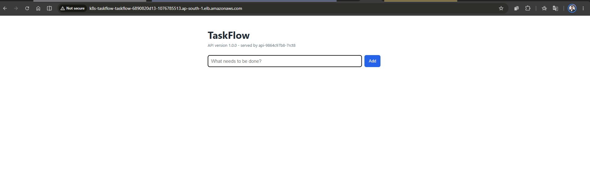

---

## What this project demonstrates

| Area | What I built |
| --- | --- |
| **Infrastructure as Code** | Terraform for a multi-AZ VPC, public and private subnets, a NAT gateway, an **EKS 1.36 cluster in Auto Mode**, and ECR repositories |
| **Containers** | Multi-stage Dockerfiles, non-root users, health checks, `.dockerignore`, images pushed to **Amazon ECR** with scan-on-push |
| **Kubernetes** | Deployments, StatefulSet, Services, ConfigMap, Secret, Ingress, HorizontalPodAutoscaler |
| **Environments** | **Kustomize** base and overlay, so one set of manifests is reused, with AWS-specific changes kept separate |
| **Networking** | Internet-facing **Application Load Balancer** created from a Kubernetes Ingress; app nodes in private subnets |
| **Storage** | PostgreSQL on an encrypted **gp3 EBS** volume through a StorageClass and PersistentVolumeClaim |
| **Reliability** | Startup, liveness and readiness probes; zero-downtime rolling updates; resource requests and limits |
| **Scaling** | HPA (2 to 5 API Pods on CPU); EKS Auto Mode adds and removes EC2 nodes to fit the Pods |
| **Observability** | **Prometheus and Grafana** (kube-prometheus-stack via Helm), custom Grafana panel, **k9s**; load generated inside the cluster to trigger autoscaling |
| **Security** | Non-root containers, read-only root filesystem, dropped Linux capabilities, seccomp, private subnets, ECR vulnerability scanning |
| **Cost control** | AWS Budget alarm, resource tagging, and a documented teardown order |

---

## Architecture

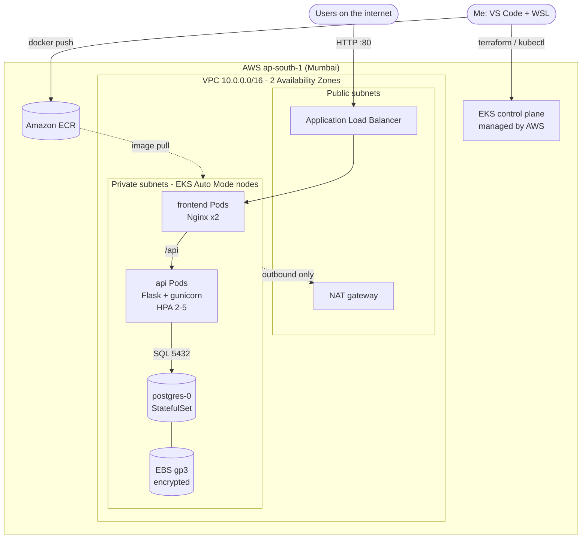

- Only the **load balancer** is public. All Pods run on nodes in **private subnets**.
- The ALB sends all traffic to Nginx, which serves the page and forwards `/api` to the API Service.
- **EKS Auto Mode** launches and patches EC2 nodes, and provides the load balancer controller and EBS driver.

---

## Tech stack

| Layer | Tools |
| --- | --- |
| Cloud | AWS: EKS (Auto Mode), VPC, ECR, ALB, EBS, NAT gateway, IAM, Budgets |
| IaC | Terraform, `terraform-aws-modules/vpc` and `terraform-aws-modules/eks` |
| Containers | Docker, Docker Desktop with WSL 2 |
| Orchestration | Kubernetes 1.36, Kustomize, Helm |
| Monitoring and testing | Prometheus, Grafana, k9s, busybox load generator, k6 |
| App (sample) | Python Flask, gunicorn, Nginx, PostgreSQL 16 |

---

## Repository structure

```
.
├── api/                      Flask API
│   ├── Dockerfile            multi-stage build, non-root user, health check
│   ├── .dockerignore
│   ├── app.py                (sample app code)
│   └── requirements.txt
├── frontend/                 Nginx: serves the page and proxies /api
│   ├── Dockerfile
│   ├── nginx.conf
│   └── index.html            (sample app code)
├── k8s/                      Kubernetes base manifests
│   ├── 00-namespace.yaml
│   ├── 01-configmap.yaml
│   ├── 02-secret.yaml
│   ├── 03-postgres.yaml      StatefulSet + headless Service
│   ├── 04-api.yaml           Deployment + Service
│   ├── 05-frontend.yaml      Deployment + Service
│   ├── 06-ingress.yaml
│   ├── 07-hpa.yaml
│   └── kustomization.yaml
├── k8s-aws/                  Kustomize overlay for EKS
│   ├── kustomization.yaml    ECR image names, patches
│   ├── storageclass.yaml     EBS gp3, encrypted
│   ├── ingressclass.yaml     ALB via EKS Auto Mode
│   └── ingress-patch.yaml
├── infra/                    Terraform
│   ├── versions.tf
│   ├── variables.tf
│   ├── vpc.tf
│   ├── eks.tf
│   ├── ecr.tf
│   └── outputs.tf
├── loadtest/
│   └── loadtest.js           k6 load test
└── docs/screenshots/
```

---

## Results

### 1. Infrastructure built by Terraform

**VPC across two Availability Zones**: public and private subnets in `ap-south-1a` and `ap-south-1b`, with separate route tables.
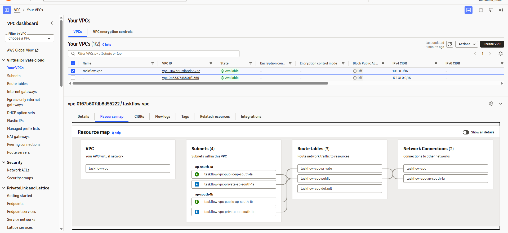

**EKS 1.36 cluster**: active, healthy, with no node or cluster health issues.
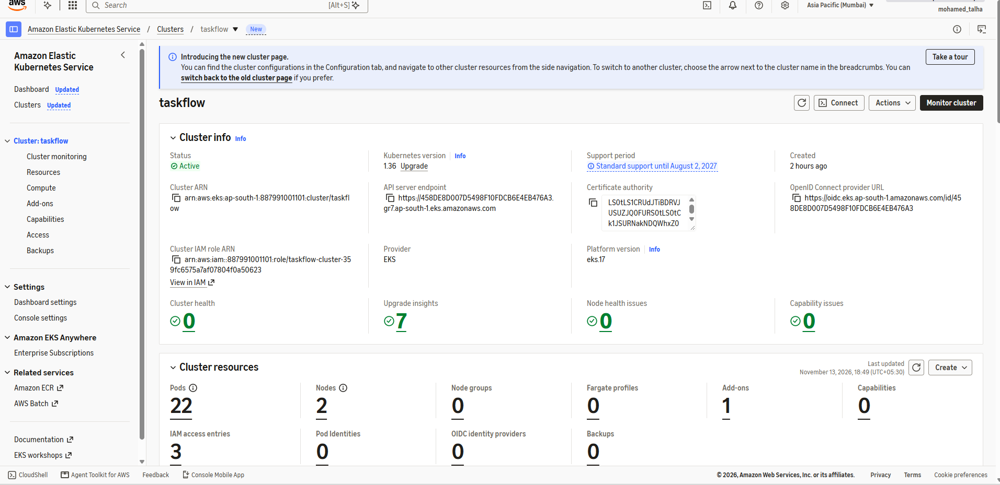

**Security groups** created for the cluster and nodes.
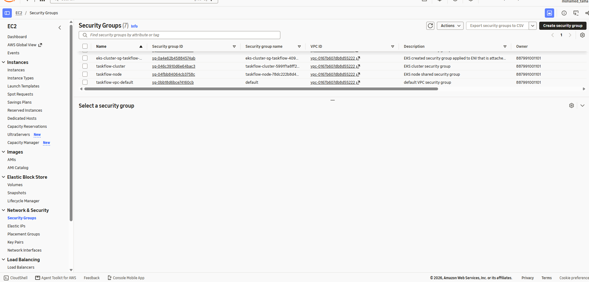

### 2. Workloads running on EKS

**All workloads healthy**: Pods, Deployments, ReplicaSets, StatefulSets and DaemonSets at 100% running.
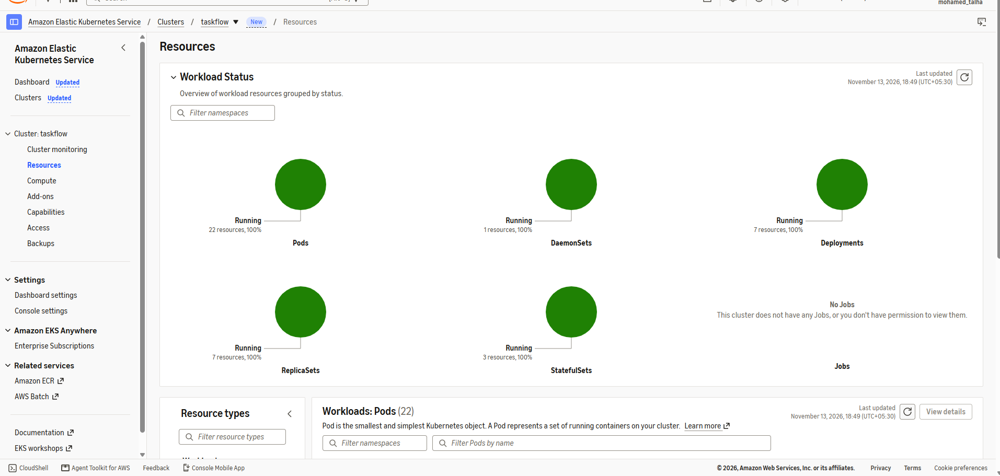

**The app's Pods next to the monitoring stack and metrics-server.**
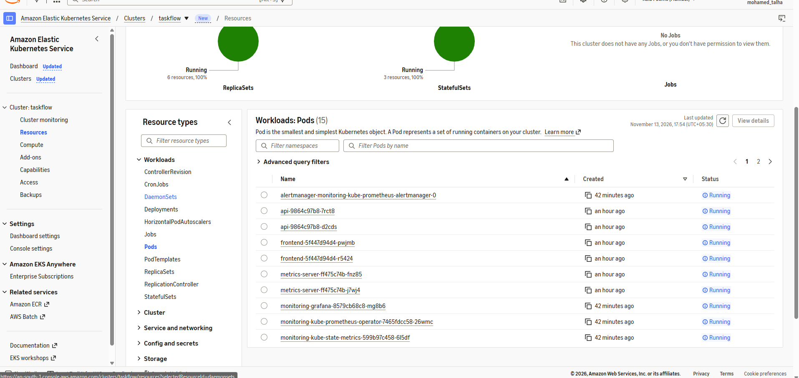

**Images in Amazon ECR**, pushed as plain image manifests so scan-on-push works.
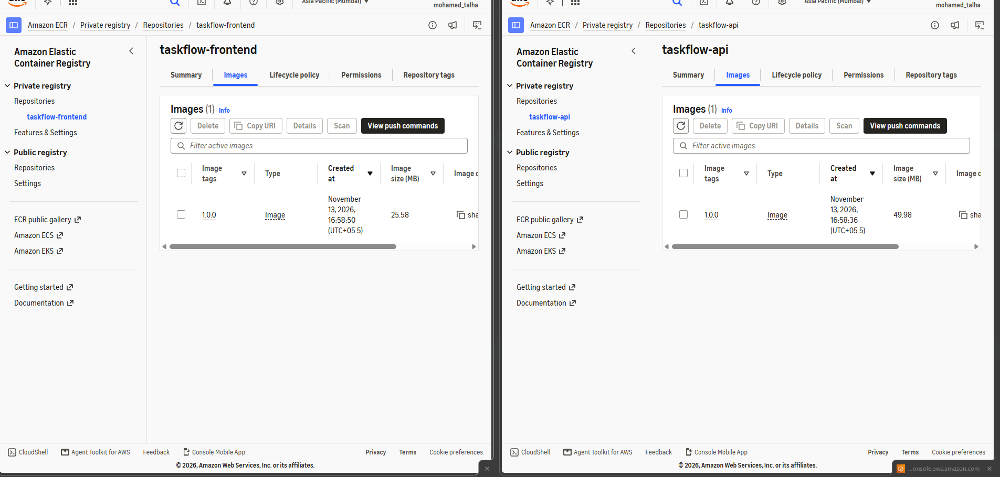

**PostgreSQL's data on an encrypted gp3 EBS volume**, created automatically from the PersistentVolumeClaim.
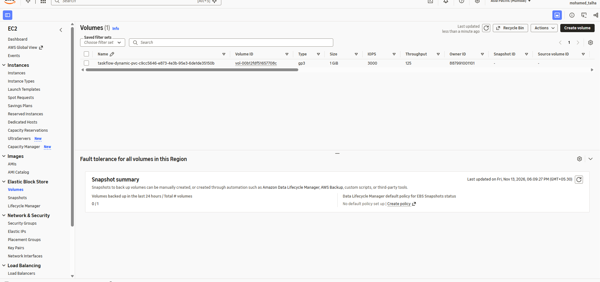

### 3. Autoscaling under load

To create load, I ran a 5-replica load generator inside the cluster, sending continuous requests to the API Service:

```bash
kubectl create deployment loadgen -n taskflow --image=busybox:1.37 --replicas=5 \
  -- /bin/sh -c "while true; do wget -q -O- http://api:5000/api/tasks > /dev/null; done"
```

**CPU jumps to about 155% of the target, and the HPA scales the API from 2 to 5 Pods.**
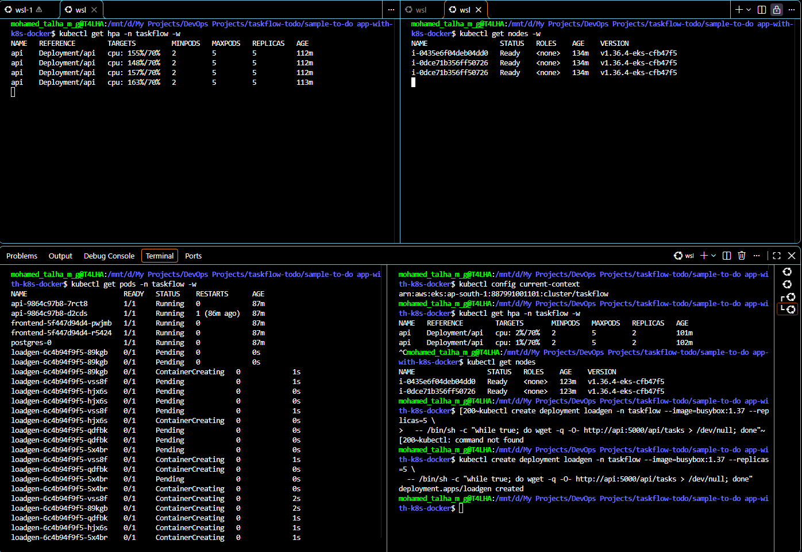

**New API Pods go from Pending to Running in about 4 seconds.**
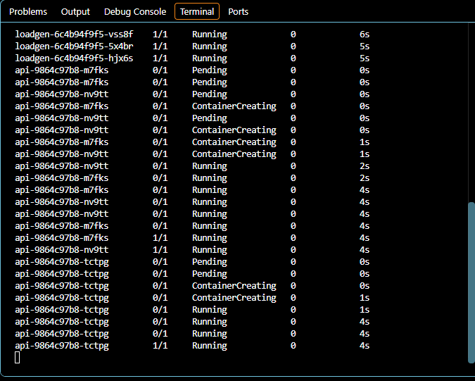

**Grafana: replicas (green) step from 2 to 5 as API CPU (yellow) rises.**
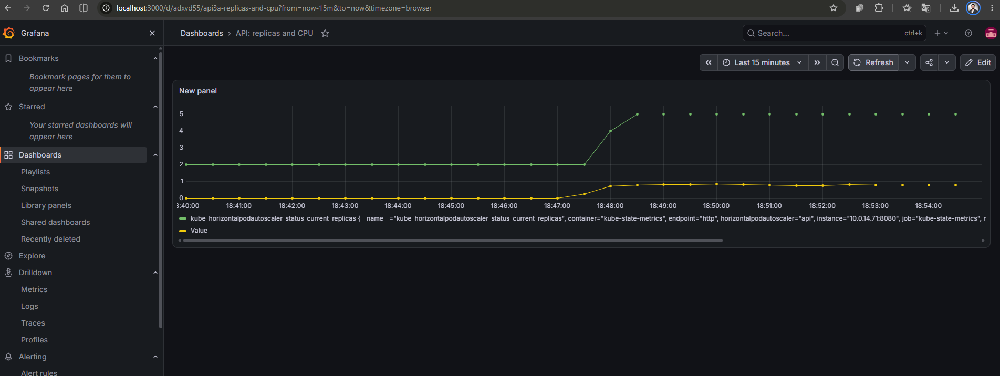

### 4. Scaling back down

**When the load stops, CPU falls from about 160% to 2%** (k9s on the left, HPA in the middle, Grafana on the right).
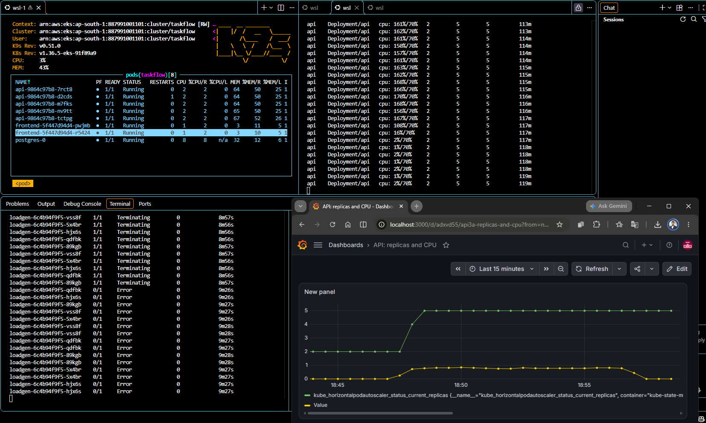

**After the stabilisation window, the HPA scales back to 2 and the extra Pods terminate.**
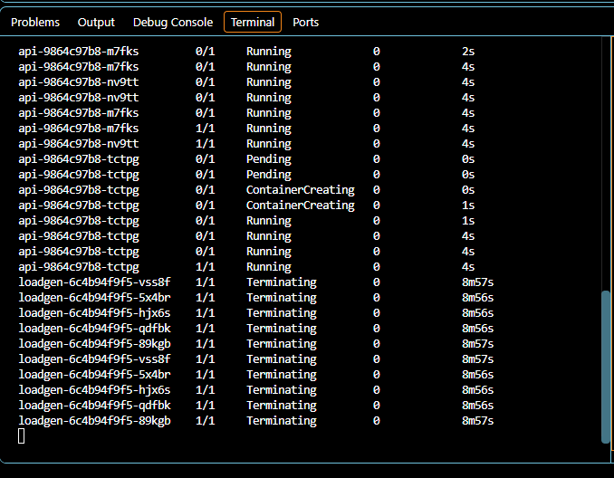
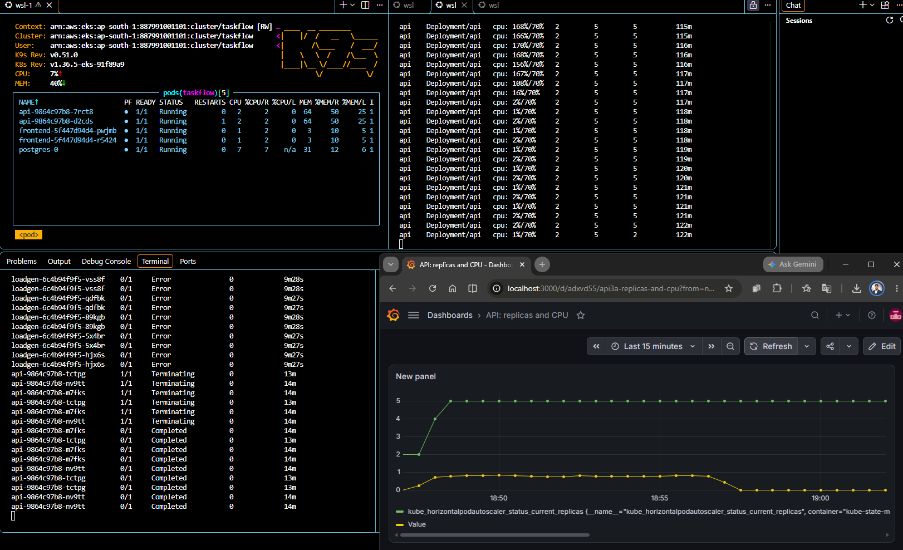

---

## How to deploy

**Prerequisites:** AWS account and AWS CLI v2, Terraform 1.5.7 or newer, Docker, kubectl, Helm.

```bash
# 1. Create the infrastructure (about 15-20 minutes)
cd infra
terraform init
terraform apply
$(terraform output -raw configure_kubectl)
cd ..

# 2. Build and push the images to ECR
export AWS_REGION=ap-south-1
export ACCOUNT_ID=$(aws sts get-caller-identity --query Account --output text)
export REGISTRY=$ACCOUNT_ID.dkr.ecr.$AWS_REGION.amazonaws.com
export VERSION=1.0.0
aws ecr get-login-password --region $AWS_REGION | docker login --username AWS --password-stdin $REGISTRY
docker build --provenance=false --sbom=false --platform linux/amd64 -t $REGISTRY/taskflow-api:$VERSION ./api
docker build --provenance=false --sbom=false --platform linux/amd64 -t $REGISTRY/taskflow-frontend:$VERSION ./frontend
docker push $REGISTRY/taskflow-api:$VERSION
docker push $REGISTRY/taskflow-frontend:$VERSION

# 3. Deploy (set your account ID in k8s-aws/kustomization.yaml first)
kubectl apply -k k8s-aws/
kubectl get ingress taskflow -n taskflow   # the ADDRESS is the public URL
```

### Monitoring and load testing

```bash
helm repo add prometheus-community https://prometheus-community.github.io/helm-charts
helm install monitoring prometheus-community/kube-prometheus-stack \
  --namespace monitoring --create-namespace \
  --set kubeEtcd.enabled=false --set kubeControllerManager.enabled=false \
  --set kubeScheduler.enabled=false --set kubeProxy.enabled=false
kubectl port-forward svc/monitoring-grafana 3000:80 -n monitoring   # http://localhost:3000

# generate load inside the cluster, watch it scale, then stop it
kubectl create deployment loadgen -n taskflow --image=busybox:1.37 --replicas=5 \
  -- /bin/sh -c "while true; do wget -q -O- http://api:5000/api/tasks > /dev/null; done"
kubectl get hpa -n taskflow -w
kubectl delete deployment loadgen -n taskflow
```

### Teardown (order matters)

```bash
helm uninstall monitoring -n monitoring
kubectl delete ingress taskflow -n taskflow      # lets EKS delete the ALB cleanly
kubectl delete -k k8s-aws/ --ignore-not-found    # deletes the EBS volume too
cd infra && terraform destroy
```

The ALB and EBS volume are created by Kubernetes, not Terraform. Deleting them first prevents `terraform destroy` from hanging on the VPC, and prevents orphaned resources that keep billing.

---

## Cost

EKS is not in the free tier. This setup costs roughly **$0.30 per hour** in `ap-south-1` (EKS control plane, one Auto Mode node, NAT gateway, ALB). I created it for each practice session and destroyed it afterwards, with an AWS Budget alarm as a safety net.

---

## Challenges and what I learned

| Problem | Cause | Fix |
| --- | --- | --- |
| ECR scan-on-push never ran | Docker Desktop's containerd image store pushed an **image index** with build attestations, which basic scanning skips | Build with `--provenance=false --sbom=false` so a plain image manifest is pushed |
| kubectl `no such host` after recreating the cluster | Each new EKS cluster gets a new API endpoint; kubeconfig still had the old one | Re-run `aws eks update-kubeconfig` after every `terraform apply` |
| `unknown field "spec.Selector"`, `apiVersion not set` | YAML keys are case-sensitive; a typo (`aipVersion`) hid the real field | Read Kubernetes' strict-decoding errors: the field path tells you the indentation level |
| `volumeClaimTemplates` rejected | Indented at the wrong level | Learned how YAML maps vs lists (`-`) map to Kubernetes object structure |
| k6 load test finished with **0 requests sent** and HPA did not move | `$APP_URL` was empty in a new terminal, so k6 had no address to call | Generated load **inside the cluster** with a busybox Deployment hitting the `api` Service; lesson: always check test output (`data_sent: 0 B`) before trusting a "pass" |
| Docker `permission denied` in WSL | User not in the `docker` group | `usermod -aG docker $USER` and restart WSL |
| Teardown risk | Kubernetes-created ALB and EBS volume are outside Terraform state | Documented teardown order: Kubernetes objects first, then `terraform destroy` |

---

## Security notes

- Containers run as **non-root** with a **read-only root filesystem**, **all Linux capabilities dropped**, and the **RuntimeDefault seccomp** profile.
- Worker nodes have **no public IPs**; only the ALB is internet-facing.
- EBS volumes are **encrypted**; ECR images are **scanned on push**.
- `k8s/02-secret.yaml` contains **demo values only**. In production I would use **AWS Secrets Manager with External Secrets Operator** instead of committing secrets.

---

## Next steps

- [ ] GitHub Actions pipeline pushing to ECR through OIDC (no stored AWS keys)
- [ ] Terraform remote state in S3 with locking
- [ ] HTTPS with AWS Certificate Manager and a Route 53 domain
- [ ] Amazon RDS instead of in-cluster PostgreSQL
- [ ] GitOps deployment with Argo CD

---

## Author

**Mohamed Talha M G**: aspiring DevOps engineer, AWS and Terraform
[LinkedIn](https://www.linkedin.com/in/YOUR-PROFILE) · [GitHub](https://github.com/YOUR-USERNAME)
